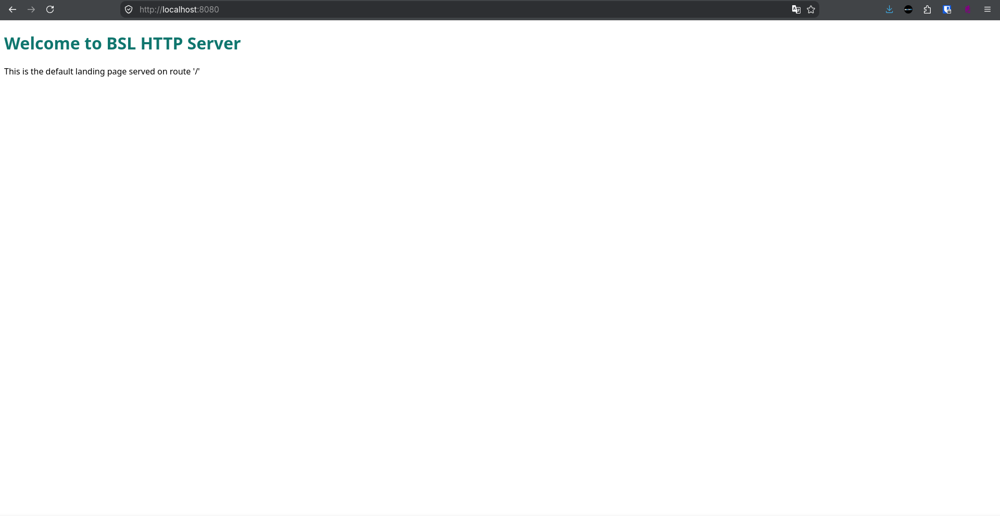
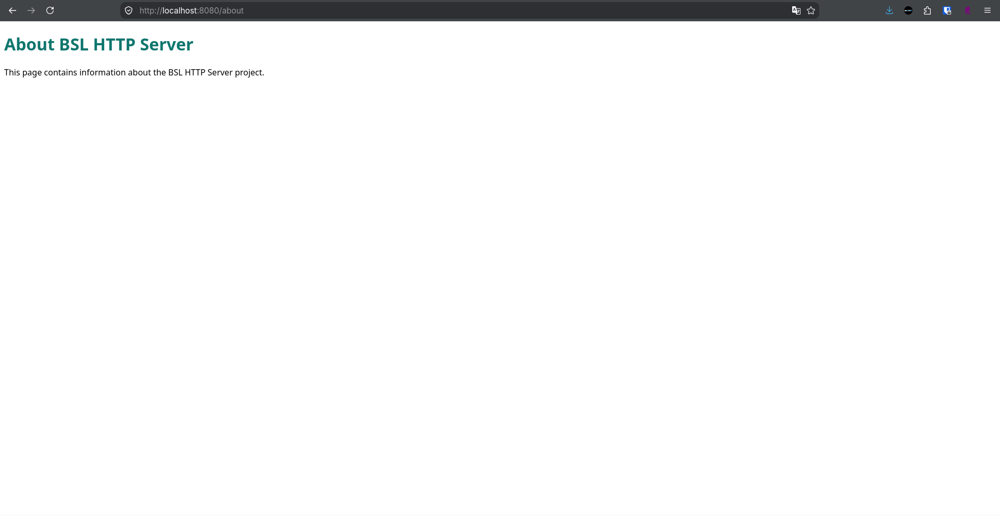
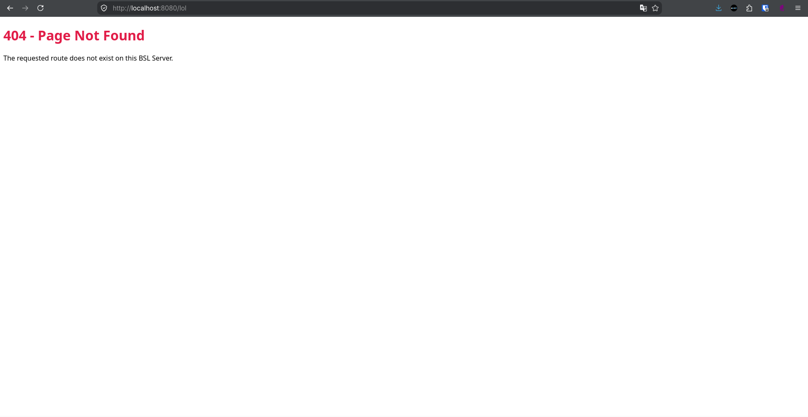
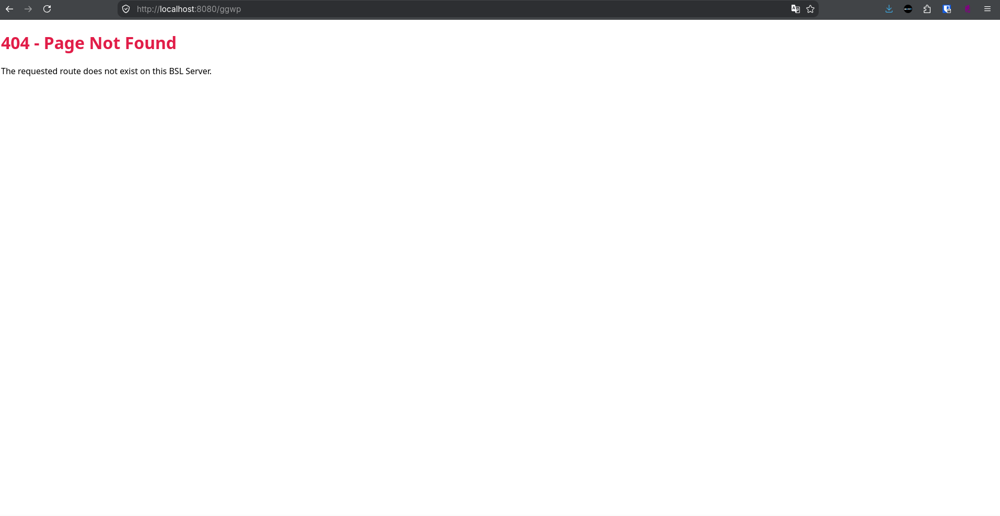
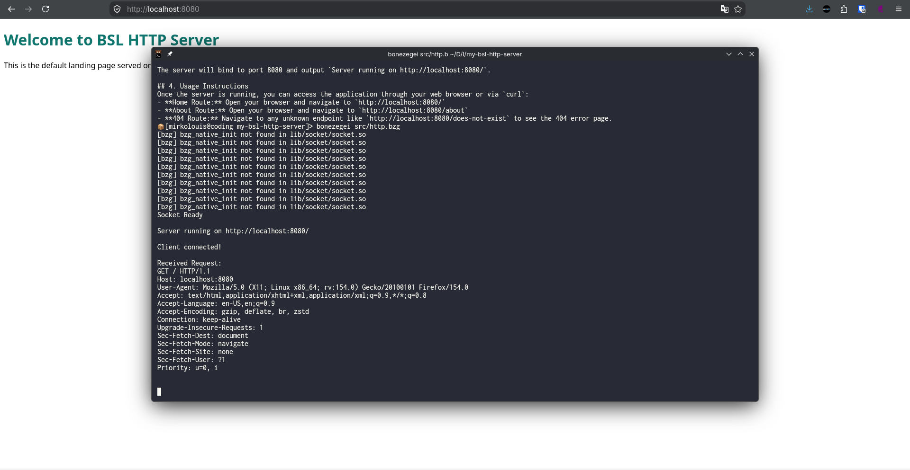

# BSL HTTP Server

## 1. Project Description
This project is a low-level HTTP Web Server built entirely from scratch using the **[Bonezegei Scripting Language (BSL)](https://github.com/bonezegei/Bonezegei_Scripting_Language)** and the BSL Socket Library. The server binds to port 8080 and handles HTTP GET requests, demonstrating fundamental web server operations, socket binding, and manual route handling without the use of high-level web frameworks. 

It handles the following routes:
- `/` - Default landing page welcoming the user.
- `/about` - About page providing information about the project.
- Any unmapped route (e.g., `/anything`) - Custom 404 Not Found error page.

## 2. Screenshots Section

### Home Page (/)


### About Page (/about)


### 404 Not Found Page (/anything)



### Terminal Server Output


## 3. Installation & Setup Guide

### Installing the BSL Interpreter
1. Open Visual Studio Code.
2. Install the **Bonezegei Scripting Language Formatter** extension from the Extensions tab.
3. Follow the instructions provided by the extension to install the native BSL interpreter for your operating system.

### Installing the BSL Socket Library
Navigate to the root directory of this repository and run the following command to install the required socket library:
```bash
bzg install socket
```

### Running the Server
To start the HTTP server, execute the following command in your terminal:
```bash
bonezegei src/http.bzg
```
The server will bind to port 8080 and output `Server running on http://localhost:8080/`.

## 4. Usage Instructions
Once the server is running, you can access the application through your web browser or via `curl`:
- **Home Route:** Open your browser and navigate to `http://localhost:8080/`
- **About Route:** Open your browser and navigate to `http://localhost:8080/about`
- **404 Route:** Navigate to any unknown endpoint like `http://localhost:8080/does-not-exist` to see the 404 error page.
